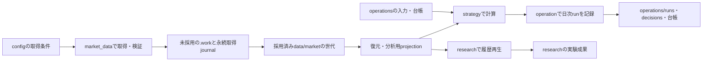

# stock.jp を統合する構成案

2026-10-04のGitHub `main`、`f34456802cf7969ec25e3fb4a32ed03396a66591` を確認した提案です。
コード・データの移動はまだ実施していません。

個人用の一つの非公開プロジェクトとして、`stock.jp/` の内容をすべて統合します。
配置は責務で決め、設定・入力・保存済みの事実ごとに正本を一つ定めます。
旧パスへのsymlink、互換CLI、廃止済みworkflowの受け口は設けません。

## 現在の責務

追跡ファイルは934件。本体のPythonモジュール65件と、ルート側のPythonモジュール4件を確認しました。

| 責務 | 主な現在の実装・保存先 |
| --- | --- |
| 市場・開示情報の取得 | `jquants_ingest.py`、`jquants_daily.py`、`jquants_history.py`、`official_source_scan.py`、`non_edinet_sources.py`、`market_regime_sources.py` |
| 保存・復元・入力検証 | `market_data_git.py`、`jquants_archive_validation.py`、`jquants_snapshot.py`、`price_snapshot.py`、`nightly_jquants_cache.py` |
| 戦略の計算 | `investment_case.py`、`market_regime.py`、`liquidity_window.py`、`position_sizing.py`、`tenbagger_v03_price_rules.py` |
| 日次運用・注文候補・状態 | `nightly_operation.py`、`daily_operation.py`、`assessment_pipeline.py`、`order_ticket.py`、`operation_state.py`、`run_integrity.py`、`operations/private/` |
| 運用可否・復旧確認 | `operation_bootstrap.py`、`operation_policy.py`、`live_gate_evidence.py`、`limited_live.py`、`recovery_drill.py` |
| 研究・履歴再生 | `historical_replay.py`、`tenbagger_price_scan.py`、`tenbagger_v02_price_exit_sim.py`、`tenbagger_v04_allocation_replay.py`、`stock.jp/data/` の研究成果 |
| 実行環境・GitHubへの保存・監視 | `actions_*.py`、`daily_publication.py`、`git_sandbox.py`、ルートの `operation_health.py` と `validate_checkout.py`、`.github/workflows/` |

上記のファイル名だけの記載は `stock.jp/scripts/` 基準です。
取得・計算・運用・研究に共通する実装と、Actionsの実行環境固有の実装を分けます。

## 現構成で整理する点

- `scripts/`、`tests/`、`docs/`、READMEがルートと `stock.jp/` に分かれています。コードはsymlinkと二通りのimportで接続されています。
- CLIの `--root` がGitルートを指すものと `stock.jp/` を指すものがあり、保存先を同じ基準で指定できません。
- Python依存が `stock.jp/pyproject.toml`、README、複数workflowに手書きされています。CIで使用するPyYAMLは現在のpyprojectにはありません。
- `stock.jp/data/` に市場の入力データと研究の出力が混在しています。旧日足CSV516件と、現行J-Quantsの保存領域を区別する必要があります。
- 採用済みJ-Quantsはversion 2のJSON/CSVですが、READMEや保存手順には圧縮世代の説明が残っています。
- READMEはActionsを検証・監視専用と説明していますが、`daily-collector-disabled.yml` には条件付きの手動取得入口が実装されています。配置と名称は現在の実装に合わせます。
- `format-check`、`operation-tests`、`daily-stock-prices` がテストとsmokeを重複実行しています。旧同期script、停止用workflow、Cloudflareの互換Workerも残っています。

## 推奨ディレクトリ

```text
stock.jp.private/
├── README.md                         # プロジェクトの入口・セットアップ
├── pyproject.toml                    # Python依存・開発用依存・CLI定義
├── package.json                      # Markdown検査・Git hookの開発ツール
├── config/
│   ├── sources.json                   # 取得元・プラン・取得範囲・品質条件
│   ├── policy.json                    # PAPER/LIVE・採用ルール・資金上限
│   └── automation.json                # Actionsの実行範囲・承認設定
├── src/stock_jp/
│   ├── cli.py                        # 一つのコマンド入口
│   ├── workspace.py                  # repo root・配置・設定の共通解決
│   ├── market_data/                  # 取得・保存・復元・正規化・検証
│   │   ├── jquants/                  # API client・catalog・日次/履歴取得
│   │   ├── edinet.py
│   │   ├── jpx.py
│   │   ├── storage.py
│   │   └── prices.py
│   ├── strategy/                     # ルール・希薄化・SAM/SOM・MRS・配分
│   ├── operation/                    # 日次処理・台帳・注文候補・readiness
│   ├── research/                     # 履歴再生・比較実験の実装
│   └── automation/                   # GitHub・永続checkpoint・PR・監視
├── tests/                            # 上記の責務と対応するテスト・fixture
├── templates/                        # 空の台帳・判断記録・reportの雛形
├── data/market/
│   ├── jquants/                      # 採用済みobject・世代索引・current.json
│   └── legacy-prices/                # 取り込み済みの過去価格・出典manifest
├── research/
│   ├── price-episodes-2016-2026/      # 実験README・入力manifest・結果
│   ├── allocation-replay-2025/
│   └── historical-replay-2025-2026/
├── operations/
│   ├── state.json                    # 運用の現在位置
│   ├── source-watermarks.json
│   ├── run-history.csv
│   ├── acquisition/                  # 取得journal・予約・消費予算の記録
│   ├── ledgers/                      # 売買・資金イベントと保有集計
│   ├── inputs/                       # 監視対象・会社別の仮定と一次資料参照
│   ├── decisions/                    # 個別の判断記録
│   ├── runs/                         # 日付ごとのreport・注文候補・証跡
│   └── evidence/                     # 本人承認・復旧・LIVE等の確認記録
├── docs/
│   ├── README.md                     # 一つの資料索引
│   ├── architecture/                # 全体構成・データの流れ
│   ├── operations/                  # 取得・日次・復旧の実行手順
│   ├── rules/                       # 戦略の説明・凍結した版の仕様
│   └── archive/                     # 過去の移行・review記録
├── .agents/skills/                   # 運用skill。正本の資料へリンク
├── .github/workflows/
│   ├── ci.yml                       # format・test・guardrailを一度ずつ実行
│   ├── market-data-manual.yml        # 現行の条件付き手動取得
│   └── operation-health.yml         # 保存済み運用記録の監視
├── .work/                           # Git除外。未採用取得・staging・復元作業
└── .cache/                          # Git除外。正本から再生成できる派生物
```

追加の提供元の採用データも `data/market/<provider>/` に置きます。
必要になったディレクトリだけを作ります。`.work/` の未保存応答や途中取得の記録は、
再生成可能な `.cache/` と区別します。

一つのPython packageとして通常のimportを使い、ルートで `pip install -e '.[dev]'` を実行します。
CLIは `python -m stock_jp` に統一します。`data collect`、`data verify`、`data restore`、
`operation run`、`operation status`、`research replay` などを既存処理へ接続します。
`workspace.py` がrepo rootを一度解決し、各処理へ渡します。
固定の配置パスもここに集約し、各moduleやworkflowへ同じ文字列を散在させません。

## 正本とデータの流れ

| 対象 | 正本 | 派生物・説明の扱い |
| --- | --- | --- |
| 取得条件・運用設定 | `config/` の各ファイル | README・workflowは同じ設定を参照する |
| Python依存 | `pyproject.toml` | README・CIで個別の依存一覧を管理しない |
| 取得済み市場入力 | `data/market/<provider>/` の採用済み世代 | 復元済みファイル・分析用CSVは世代IDとhashで正本を参照する |
| 取得予約・消費予算 | 単一の永続取得journal | Actionsとローカルで復元した同じ記録を使う。実行し直して残枠を初期化しない |
| 戦略の数値・計算 | `src/stock_jp/strategy/` | `docs/rules/` は意味・根拠・版を説明し、数値表を別途手編集しない |
| 売買・入出金の事実 | `operations/ledgers/` のイベント台帳 | 保有・残高・集中度は台帳から照合できる集計として扱う |
| 会社別の入力・判断 | `operations/inputs/`、`operations/decisions/` | 取得元の事実、計算結果、個人の仮定を区別する |
| 当日の実行結果 | `operations/runs/<date>/` | reportは当該runの注文候補・証跡・入力世代を参照する |
| 研究成果 | `research/<experiment>/` | README・入力manifest・結果を同じ実験単位にまとめる |
| 現在の準備状況 | 設定・入力・証跡から計算するstatus | READMEに現在のGO/NO-GO判定を繰り返し記載しない |

承認scopeやrunの入力snapshotは、その時点を固定した証跡です。現行設定の別の更新先にはしません。



取得・保存・計算の実装は実行環境をまたいで共用します。`automation/` はGitHubとの通信、
永続journalの更新、実行所有者の照合、PR保存を担当します。研究処理は採用済み入力を読み、
運用の状態・注文・台帳を書き換えません。台帳やrunを更新する処理は `operation/` に集約します。

市場入力の保存は現行version 2を使い、元のJSON/CSVの内容・hash・世代参照を保持します。
分析用の変換結果は生成元を明示します。旧価格を現在の公式入力へ混ぜません。
取得journalには未採用・失敗・不明結果の消費も残し、移動に伴う再初期化を行いません。

## stock.jp/ を含む移動・統合

| 現在 | 移動・統合先 |
| --- | --- |
| `stock.jp/scripts/` とルートのPython実装 | `src/stock_jp/` の各責務へ統合 |
| `stock.jp/tests/` と `tests/` | 一つの `tests/` と共通fixture |
| `stock.jp/pyproject.toml` | ルートの `pyproject.toml` |
| `stock.jp/operations/templates/` | `templates/`。設定の雛形は現在の設定の別正本にしない |
| `operations/private/source-config.json`、`operation-policy.json` | `config/sources.json`、`config/policy.json` |
| `.github/stock-automation-approval.json`、退役証跡 | `config/automation.json`、`operations/evidence/`。承認内容と消費済み予算を保持 |
| `operations/private/` の状態・入力・台帳・run | `operations/` の対応する責務へ配置 |
| 財務予想・株式数・決算予定の公表時点履歴 | 市場の観測記録として `data/market/` に配置。出典と観測時点を保持 |
| `stock.jp/data/jquants-archive/` | `data/market/jquants/`。世代内の論理名とobject内容を保持 |
| `stock.jp/data/daily-prices/` | `data/market/legacy-prices/`。過去の入力とmanifestを保持 |
| `stock.jp/data/tenbagger-*`、両側の研究report・replay入力 | `research/<experiment>/` に実験ごとに集約 |
| `stock.jp/docs/` とルートの `docs/` | 一つの `docs/`。同じ手順は一つにまとめ、過去の報告は `docs/archive/` |
| `stock.jp/.agents/` | ルートの `.agents/`。資料と新CLIへの参照を更新 |
| `stock.jp/README.md`、`.gitignore` | ルートへ内容を統合 |
| `stock.jp/.github/` | コピーを削除し、ルートのworkflowへ必要な検証だけを統合 |
| symlink用setup、旧submodule用script・workflow、Cloudflare互換Worker | コードを削除。必要な退役記録は `docs/archive/` と証跡へ保存 |

過去の戦略版・実験・判断・取得消費は、日付と版を持つ記録として保持します。
最新手順を複製した互換資料は残しません。停止用ローカルコードの整理と、外部環境の操作は別です。

## 実装の順序と確認

1. package・設定・workspace解決を一本化し、コード・テスト・skill・テンプレートとデータ参照を新配置へ移す。各変更と参照元の修正を同じ変更に含める。
2. 取得・保存・分析用変換・日次運用の境界を整理する。J-Quantsの日次・履歴・夜間取得でclientと検証を共用し、GitHub固有処理を `automation/` へ寄せる。
3. 資料を一つの索引と用途別の短い手順へ統合し、廃止コードと重複CIを削除する。CIの `format`・`test`・`guardrail` という検査名は維持する。

移動前後で市場データの全hash、取得消費、台帳、run ID、入力・証跡の対応を照合します。
既存テストとネットワークを使わないsmoke、JSON/CSV世代の復元、単一cloneからの起動を確認します。
承認hash、保存先allowlist、復旧のcode tree参照も新配置に合わせて検証し、
過去の成功証跡を新構成の確認結果へ書き換えません。
完了時に `stock.jp/`、互換link、旧実行入口、二重の資料索引が残っていないことを確認します。
