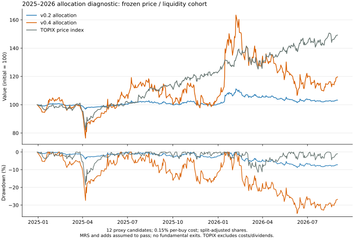

# 一次資料と過去検証：2026年10月5日

2025年1月6日〜2026年8月31日の404営業日で、v0.2とv0.4の資金配分を比較した。
保存済み公式株価565日をハッシュで照合し、再生期間の取引日をJPXの指数日付でも照合した。
2025年末の資産は、既存の2025年検証結果と一致する。

**資金配分の診断は完了。ルール全体の正式な過去検証とLIVE条件は未達。**
全銘柄の当時の財務・採点・開示・MRS・出口判定を再構築した検証ではない。
運用モードはPAPER、発注境界はHUMAN_ONLYのまま。
復旧試験は利用者の明示指示で実施せず、LIVE・LIMITED_LIVE必須条件からも除外した。

## 結果

初期資産は比較用の1,000万円。2024年12月30日までの価格・流動性で選んだ12銘柄を固定した。
MRSはNORMAL、追加条件は全候補通過と仮定し、初回と2025年4月・7月の追加後は保有を継続した。
財務による入口・出口、配当、税は含めない。購入ごとに0.15%の費用を控除した。

| 指標 | v0.2 | v0.4 |
| --- | ---: | ---: |
| 期末資産 | 10,325,483円 | 11,969,167円 |
| 期間損益 | +3.25% | +19.69% |
| 最大下落率 | 8.74% | 34.80% |
| 取得原価の投資率 | 13.31% | 99.42% |
| 期末の待機資金比率 | 83.94% | 0.36% |

TOPIX価格指数は2024年12月30日終値から2026年8月31日終値まで**+49.24%**、
グロース250価格指数は**+26.06%**だった。v0.4はTOPIXを29.55ポイント下回った。
指数は配当・費用なしの終値比較で、ポートフォリオは翌営業日の寄付・指値による約定比較。
原系列は[benchmark.csv](benchmark.csv)、計算は[benchmark-summary.json](benchmark-summary.json)にある。



[PNG](allocation-chart.png)も保存した。
候補・約定・日次資産は[検証詳細](continuous-allocation.md)、
機械可読の結果は[continuous-summary.json](continuous-summary.json)にある。
現在の未承認holdout案の下落率floorは−30%。この代理診断の−34.80%はそれを超える。
未承認の案を合格基準として採用したり、結果に合わせて変更したりはしない。

## 費用の感応度

| 購入時の費用 | v0.2損益 | v0.4損益 | v0.4最大下落率 |
| --- | ---: | ---: | ---: |
| 0% | +3.27% | +19.54% | 34.89% |
| 0.15% | +3.25% | +19.69% | 34.80% |
| 0.50% | +3.21% | +19.34% | 34.88% |

0%では余剰資金で3825を100株多く買い、その追加分が損失になったため、
費用と最終損益は単調な関係にならない。全ケースを同じ候補で実行した。
[fee-sensitivity.json](fee-sensitivity.json)と各`fee-*-trades.csv`に根拠を保存した。

アセンテック3565の1対3分割は会社IRで確認した。
法的効力発生日は2026年5月1日、株価の権利落日は4月28日。
経済価値の再生では4月28日の買付前に保有数量を3倍にした。
[splits.json](splits.json)で原本・日付・比率を固定し、原株価CSVは変更していない。
未確認の大幅な価格変化や端株の現金精算が必要な併合は、推測で補わず停止する。

## 集めた一次資料

| 対象 | 保存・確認内容 | 資料一覧 |
| --- | --- | --- |
| フィーチャ4052 | 2021〜2026年の法定・決算資料等49件、1,086頁。最新有報と成長計画を部分レビュー | [company-primary-sources.json](company-primary-sources.json) |
| JPX | 2024年12月〜2026年8月の指数PDF21か月。全月を読み取り、TOPIX・グロース250を抽出 | [market-components.json](market-components.json) |
| 日経VI・内閣府CI | VIは2023年1月〜2026年9月30日の914日、CIは9月29日公表の7月改訂値と比較用系列 | [market-primary-sources.json](market-primary-sources.json) |
| アセンテック3565 | 1対3分割の会社公告 | [splits.json](splits.json) |

原本は `data/market/primary-sources/<SHA-256>.<拡張子>` に1件ずつ保存した。
資料一覧にURL、公表・取得日時、ハッシュ、頁数、レビュー範囲を残す。
公表時刻が日付しか分からない資料は、その日の23:59:59 JSTから利用可能として扱う。
49件すべての精査、全社資料の収集、過去の原公表値・訂正履歴の検証は完了していない。
今回J-Quantsへの通信は0回。既存の保存済み世代を使った。

フィーチャの最新有報で、2026年6月期の売上543,871千円、純利益42,530千円、
営業CF−77,337千円、現金528,738千円を確認した。売上債権の増加を含め、
黒字と資金流入を区別する。報告された潜在株式22,620株と全数行使時の払込額22,620千円、
無限定適正の監査意見も確認した。
数字・期間・参照頁・未確認項目は[4052-primary-review.json](4052-primary-review.json)が正本。
SAM/SOM、非定常CF調整、最新の希薄化状況等が不足しており、購入判定はWAIT。
この2026年9月公表資料を過去の選定へ遡及利用していない。

## 正式検証の不足

[coverage-audit.json](coverage-audit.json)では、月末価格表に現れる国内銘柄は
2024年12月〜2026年8月の合計**79,369銘柄時点**、正式な全条件採点は**0件**だった。
価格に現れない銘柄も含む厳密な当時母集団は未認証なので、この数は正式な分母の確定値ではない。
財務履歴94,982件、株数履歴80,941件等の保存だけでは、粗利益・潜在株式・開示内容の確認を代替できない。

必要な残りは、当時の全銘柄master・廃止・合併、訂正を含む当時の財務・重要開示、
全ハードゲートと採点、SAM/SOM・競合比較・10倍逆算、MRS、全出口・未約定の再生。
JPX月次PDFの当月値は翌月に公表されるため、当月末のMRSへ利用できない。
9月末のMRSには同月末までの指数と200日系列が必要で、月次PDFからは8月末までしか得られない。
過去のCI公表時点の系列と、2025年初のVI算定に必要な2022年系列も未補完。

正式な`validate`と`run`は実行し、未確認入力を理由に停止した。
[formal-validation.json](formal-validation.json)、[formal-run.json](formal-run.json)に終了コードと不足理由を保存した。
正式な損益や合格証跡は生成していない。
2025〜2026年8月は回顧的検証であり、v0.4凍結後に事前固定する未観測holdoutを代替しない。
本人のリスク確認・最終承認も未完了。復旧試験の免除はこれらの免除を意味しない。

## 再現

リポジトリルートで実行する。旧価格と固定世代のオブジェクトから入力を作るため、
`.work/market-data/`の現在の復元状態や将来の夜間更新に依存しない。通信は行わない。

```bash
python -m pip install -e '.[research]'
python research/validation-2026-10-05/reproduce.py
python research/validation-2026-10-05/plot.py
```

[price-input-register.json](price-input-register.json)が価格の正本指定、
[provenance.json](provenance.json)が入力・実行コード・結果のハッシュと既存2025年結果の照合記録。
正式な入力契約とLIVE条件は[過去検証の手順](../../docs/operations/historical-replay.md)を参照する。
